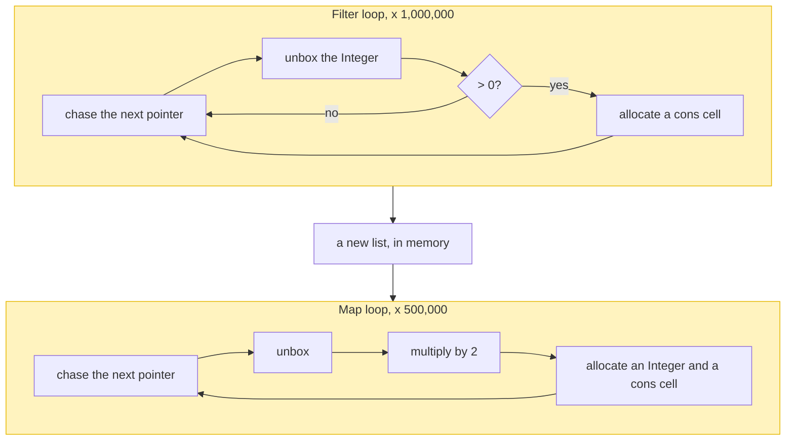
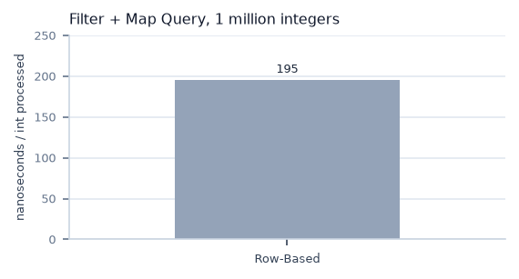
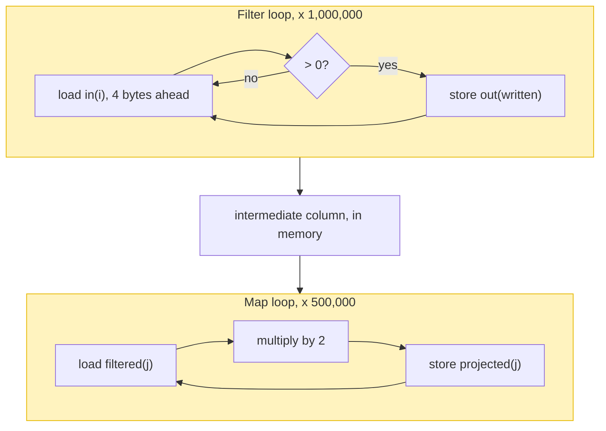
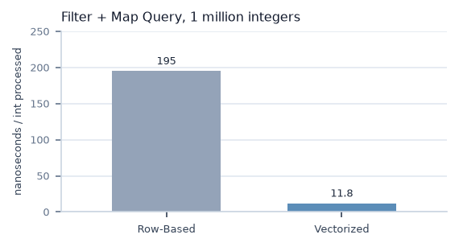
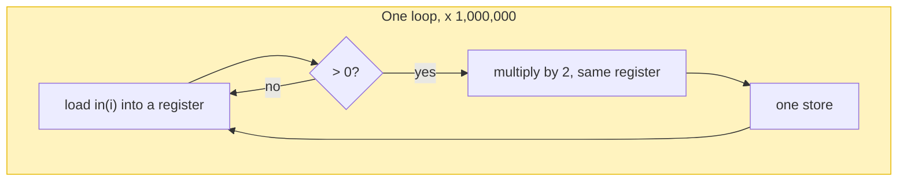
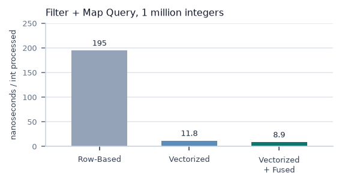
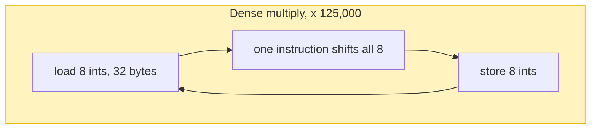
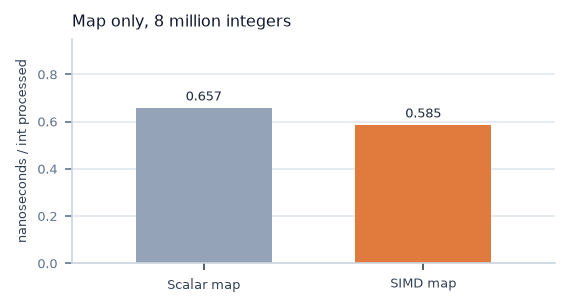

Vectorization is the technique of running a tight loop over a column of values, typically a few thousand values at a time. It's used by ClickHouse, DuckDB, Numpy, Datafusion, and all modern analytical processing engines. 

This contrasts with how most backend data systems work. Postgres and MySQL walk one record at a time. Spark SQL also steps one record at a time inside a stage. The values are raw bytes, not an object each. The Parquet reader is the part that is actually columnar, and it turns those columns back into rows for the rest of the plan. For analytical use cases, where filters and aggregations on large columns are common, vectorization has become the standard because it is so much faster.

Vectorization works in any language; it doesn't need a native language like C++ or Rust (a common misconception). In fact, this post builds the entire engine in pure Scala to demonstrate; the principles apply no matter what language is in use.

---

## 1. Row-based Engine

Let's start with a basic query operation with a `filter` and `map` stage in Scala: 
```scala
values.filter(_ > 0).map(_ * 2).collect()
```

To implement this in a basic query engine, we define operators for each of the `filter` and the `map`, each of which take a function `f` as a parameter. Each operator here uses a simple iterator to walk over each element in `values`. 

```scala
def filter[A](f: A => Boolean): Stage[A, A] = {
  SingleOpStage { p =>
    val it = p.data.iterator.filter(f)
    Partition(IterUtil.iterableOf(it))
  }
}

def map[A, B](f: A => B): Stage[A, B] = {
  SingleOpStage { p =>
    val it = p.data.iterator.map(f)
    Partition(IterUtil.iterableOf(it))
  }
}
```
This query walks over all elements and calls the `filter` function on each, allocates memory, and creates a new `Partition` data structure for that result. It then does the same with the `map` function on each element, again allocating a new `Partition` for the result. That's a lot of steps!

For this case, the data is not physically located together in memory. Since each int is its own object, the next value is a pointer chase away rather than at the next 4 bytes. The CPU loads each value into memory, processes it, reads the pointer for the next value, then goes all the way back to memory to fetch it.

Another potential slowdown is that of type conversions, or "boxing" as it's known in the JVM. The simple row-based Scala engine converts from the `java.lang.Integer` to a raw 4-byte int before doing the comparison, then boxes the result back into `java.lang.Integer`. This is true (to some extent) for all high-level languages like Scala which manage types.

Due to both one-by-one processing and boxing, the row-based engine on the 1 million element list is pretty slow! The row engine's `collect` of the same query took about 195 ms and allocated about 84 MB, on 4 threads. A million raw ints are 4 MB, so that is about 20× the data.





## 2. Vectorized Engine

The key principle to understand for vectorization is that of contiguous data. When the engine sets the data to be processed as an entire column (or vector) at once, the next value is always 4 bytes away from the current value.

The column is stored in a contiguous location of memory addresses: in our case the 1 million ints take 4MB of contiguous addresses.

In the engine, that column is an `Array[Int]`, and the kernels are plain `while` loops over it. Each step handles one int. No SIMD instruction is required, and the filter stays one int wide even when HotSpot's auto-vectorizer is on. This is the unfused columnar engine the earlier Scarlet timings measured: two passes, one value at a time. 

```scala
def filterInt32(in: Array[Int]): (Array[Int], Int) = {
  val out = new Array[Int](in.length)
  var written = 0
  var row = 0
  while (row < in.length) {
    if (in(row) > 0) {
      out(written) = in(row)
      written += 1
    }
    row += 1
  }
  (out, written)
}

def projectInt32(in: Array[Int], length: Int): Array[Int] = {
  val out = new Array[Int](length)
  var row = 0
  while (row < length) {
    out(row) = in(row) * 2
    row += 1
  }
  out
}

val (filtered, survivors) = filterInt32(column)
val projected = projectInt32(filtered, survivors)
```

When the CPU starts processing the data in the column, it knows that the next value is always 4 bytes ahead of the current one. Therefore, it pulls an entire chunk of data, 64 bytes or 16 ints, from memory into L1 cache, before the CPU processing loop even asks for it. Then the CPU always has the next value available in L1, whereas in the row-based approach, the CPU needs to read the pointer then pull the next value from memory, for every single value.

Recall the standard data storage on a CPU (sizes for an Intel i7-8550U):
1. **CPU register**: directly on the CPU, accessible in 1 CPU clock cycle, for bytes being processed
2. **L1 cache**: 32KB, accessible in about 4 clock cycles
3. **L2 cache**: 256KB, accessible in 10-15 clock cycles
4. **L3 cache**: 8MB, accessible in ~20-40 clock cycles
5. **Memory (RAM)**: 12GB, accessible in ~100-400 clock cycles

In the 1-million int example, the data to process is always ready in L3 or L1 cache, so the CPU is fully saturated and speeds through the 1 million ints for the filter step, writing the filter result back to memory. Then it speeds through the map step as well. The data fetch from RAM to L3 is usually the bottleneck in reality.





## 3. Vectorized Engine with Fusing

In the previous example, the engine executes two CPU instructions on each element, so each value leaves the CPU in between the oerations. The data gets pulled from memory to L3 to L1 to CPU for the first filter, only to be pushed back to L3 then L1 then CPU again for the mutiply. With data movement being the bottleneck, the overall query is limited by moving values between cache levels up to 2 million times, for only 1 million values.

This can be optimized beforehand in the planning stage, by fusing the CPU operations into a single kernel instead. The CPU can run both the filter and the multiply step while the data is still in the register, so there is no intermediate array and no data movement.

The planner matches the chain outside the loop and picks one pipeline. For this query that is `Int32Pipeline.FP`, and `inline` pastes both functions into its loop. One pass, one output column.

```scala
case List(Filter(predicate), Project(mapper)) =>
  Int32Pipeline.FP(batch, predicate, mapper)

var written = 0
var row = 0
while (row < live) {
  val value = in(row)
  if (predicate(value)) {
    out(written) = mapper(value)
    written += 1
  }
  row += 1
}
```
Note that fusing is separate from vectorization, and it's been a common operation in query engines for a long time, including in Spark. With vectorization and fusing together though, for large column-heavy workloads, engines see massive performance benefits.





## 4. SIMD

You might have immediately thought about SIMD (Single Instruction Multiple Data), which is the more well-known form of vectorized optimizations. However we leave this until the end, to illustrate the significant gains from the simpler column loop, and from fusion, first. SIMD lives one level even deeper, within the CPU instructions themselves. 

The core idea here is exactly as it sounds: a single CPU instruction running over multiple values. In this example, the operation `out[i] = in[i] * 2` becomes a single AVX2 instruction operating on 8 ints (32 bytes) at once. All 8 ints are loaded into adjacent lanes as a contiguous block, the CPU shifts them all, then all 8 results are stored together.

For a dense `out(i) = in(i) * 2`, a plain `while` over an `Array[Int]` is not only vectorized, it is also set to automatically use SIMD on modern JVM compilers such as HotSpot. That pass is SuperWord Level Parallelism, on by default, and it can be enabled or disabled as compiler flags:

```
java -XX:+UseSuperWord ...    # on, default
java -XX:-UseSuperWord ...    # off, scalar
```

The filter and fused loops above stay one int per step with the flag either way. The multiply is the loop that changes. A Scala engine can also skip the auto-vectorizer and call the instruction explicitly, using `jdk.incubator.vector`. Here `SPECIES_256` represents 8 ints (256 bits) processed in parallel across lanes:

```scala
import jdk.incubator.vector.{IntVector, VectorOperators}

def explicitMul(in: Array[Int], out: Array[Int]): Unit =
  val species = IntVector.SPECIES_256
  val lanes = species.length()
  var i = 0
  val bound = species.loopBound(in.length)
  while i < bound do
    val v = IntVector.fromArray(species, in, i)
    v.lanewise(VectorOperators.LSHL, 1).intoArray(out, i)
    i += lanes
  while i < in.length do
    out(i) = in(i) * 2
    i += 1
```

The 8th-gen i7 used for testing doesn't support the newer instruction set (AVX-512) which would let it use SIMD on the filter and map together due to needing to drop the filtered values, so this test only measured the impact of SIMD onthe map. SIMD showed some improvement due to the faster CPU operations, but since this data is large enough to not fit entirely into cache, the operation is still bottlenecked by the fetch from memory which is not impacted by SIMD.





## On Languages

We wrote our examples here in Scala, rather than a lower-level language, to illustrate the point that vectorization itself is language agnostic. In fact, my entire for-fun processing engine project, [Scarlet](https://github.com/ewoodbury/scarlet), is in Scala yet still beats Apache Spark easily thanks in large part due to vectorization. 

Language choice has no effect once code is compiled down to the equivalent instructions within the processing loop. Of course, we saw that the JVM provides auto-vectorization and other optimizations during the compile step itself, which is in contrast to interpreted languages like Python which are stuck with executing operations as specified (although this is starting to change with the in-progress [Python JIT](https://peps.python.org/pep-0836/)).

Still, low-level languages like C++ and Rust provide more direct memory control, specifically in being able to avoid the boxing and unboxing conversion cost of values, whereas JVM languages pay the boxing tax at the beginning and end of the operation when converting raw bytes. They can also specify the exact instruction: for the filter step, a C++/Rust could the AVX-512 compress on a CPU that has it, instead of leaving that choice to the JIT compiler.
