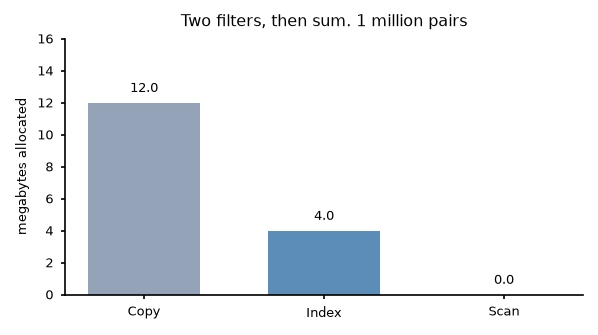
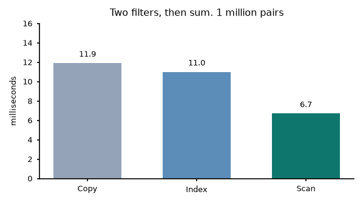

Consider a simple filter operation passed to a data processing engine:
```scala
val highEarners = salaries.filter(_.salary > 100000).collect()
```

A simple query engine executes this by first allocating a new location in memory for the result data. Then it pulls the original data from memory into the caches and then CPU, evaluates the filter, then copies only passing records into the allocated destination in memory.
```
For a dataset of [employee, salary] pairs:
(["Joe", 85000], ["Sally", 120000], ["Allen", 140000], ["Linda", 95000], ["Tony", 80000])

Engine allocates new destination in memory: 
(null, null, null, null, null)

Then fills it with surviving data:
(["Sally", 120000], ["Allen", 140000], null, null, null)
```

To do the memory allocation, the program doesn't know how many records will survive, so it allocates the new buffer as the same size as the entire input dataset in case all records pass the filter. Memory usage is doubled during the operation until the original data can be freed.

What about two filters? Or even more? Same idea - program needs to allocate a buffer in memory for every new filter result, and copy data into it after each operation. For the subsequent query:
```scala
val highEarnersA = salaries.filter(_.salary > 100000).filter(_.name.startsWith("A"))
```
```
Filtered to employees with names starting with 'A':
(["Allen", 140000], null)
```

This naive engine kernel is as follows:
```scala
def filter(
    keys: Array[Int],
    values: Array[Int],
    keep: (Int, Int) => Boolean,
): (Array[Int], Array[Int], Int) = {
  val outKeys = new Array[Int](keys.length)
  val outValues = new Array[Int](values.length)
  var written = 0
  var row = 0
  while (row < keys.length) {
    if (keep(keys(row), values(row))) {
      outKeys(written) = keys(row)
      outValues(written) = values(row)
      written += 1
    }
    row += 1
  }
  (outKeys, outValues, written)
}
```

This approach is straightforward and trivially correct. However the additional memory required and scans leave room for improvement. 

## Survivor Indices

Instead of allocating a buffer the size of the whole dataset and copying the entire survivor dataset, it can instead decide to track only row numbers of the survivor records. 
```
For a dataset of [employee, salary] pairs:
(["Joe", 85000], ["Sally", 120000], ["Allen", 140000], ["Linda", 95000], ["Tony", 80000])

Filtered to employees with salary > 100000, saving only survivor indexes
(1, 2, null, null, null)
```

In this case, the engine only allocates space for 4 `int32`s, or 16 bytes total. The large name string does not have an impact on memory usage. 

Subsequent filters can operate directly on the indexes as well, using the index as a lookup.
```
Original Dataset: (["Joe", 85000], ["Sally", 120000], ["Allen", 140000], ["Linda", 95000], ["Tony", 80000])
Current survivors: (1, 2, null, null)

Filtered to employees with names starting with 'A':
(2, null)
```
A downside is the extra time spent to do the record lookups, since the name strings only exist in the original array. The program needs to fetch the full record from the original to do the name filter, which leads to extra idle CPU cycles due to fetching from a different location in cache or memory.

The optimized engine kernel with survivor indices is:
```scala
def select(
    keys: Array[Int],
    values: Array[Int],
    keep: (Int, Int) => Boolean,
): (Array[Int], Int) = {
  val index = new Array[Int](keys.length)
  var written = 0
  var row = 0
  while (row < keys.length) {
    if (keep(keys(row), values(row))) {
      index(written) = row
      written += 1
    }
    row += 1
  }
  (index, written)
}
```


## Count and sum

Now consider the following sum operation:
```scala
salaries.filter(_.salary > 100000).map(_.salary).sum
```

Following these optimizations, an engine could save the survivor indices only throughout the computation, then do fast array lookups at the end to aggregate the total. This beats the naive approach of allocating an entire new array of the same original size.

```
(["Joe", 85000], ["Sally", 120000], ["Allen", 140000], ["Linda", 95000], ["Tony", 80000])

Filter salary > 100000, survivor indices
(1, 2, null, null, null)

Calculate final sum:
salary[1] + salary[2] = 120000 + 140000 = 260000
```

However, aggregations do not require any of the original data to be returned at the end, which unlocks a further optimized physical execution plan.

The engine can instead aggregate as it goes, so it only needs to allocate space for one additional value, and it calculates during the single scan over the original data. If the program parallelizes execution over multiple batches, each batch can have its own sum calculated, and all sums are then combined at the end. Each row is only ever touched one time.

```
(["Joe", 85000], ["Sally", 120000], ["Allen", 140000], ["Linda", 95000], ["Tony", 80000])
     |               |                  |                  |                 |
Scan:|               |                  |                  |                 |
  skip...         total=120000...    total=260000...     skip...          skip...

Return: total = 260000
```

Optimized engine kernel:
```scala
def sum(index: Array[Int], written: Int, values: Array[Int]): Long = {
  var total = 0L
  var slot = 0
  while (slot < written) {
    total += values(index(slot))
    slot += 1
  }
  total
}

def sum(values: Array[Int], keep: Int => Boolean): Long = {
  var total = 0L
  var row = 0
  while (row < values.length) {
    if (keep(values(row))) total += values(row)
    row += 1
  }
  total
}
```

## Results

Results for 1,000,000 integer pairs through 2 filters and a sum, for each of the three kernels. For this example, the first filter keeps positive values and the second filter keeps non-multiples of 3, leaving 333,062 rows which survive both.

```scala
values.filter(_._2 > 0).filter(_._1 % 3 != 0).map(_._2).sum
```



As expected, removing the full size allocation significantly reduces memory from the copy kernel to the survivor index kernel. Of course the zero-copy scan-only kernel is best with no additional memory copied. (Note the 8MB of the original source 1 million int pairs is not included in these totals, since it's the same for all.)



The survivor index kernel still writes a row number for every survivor and reads it back, so wall time is only slightly improved from the naive copy kernel. The scan adds the value while the row is already in hand.

(All results from an i7-8550U, single thread, at about 2.3 GHz. Results are the median of 9 runs after 5 warmup runs.)

## Wrap-up

Query engines are a neat way to see data structures and algorithm principles applied in real life. These optimizations are elementary, but they're illustrative of the thousands of techniques that make up the database engines that run the world.

Related and slightly more advanced techniques include operator fusing, column pruning, sorts by index, and zero-copy groupbys. I may cover these in a future post!

This is one of many optimizations built into my custom query engine scarlet, built from scratch with vectorization in Scala 3. Feel free to follow along for more writings and query engine progress.
